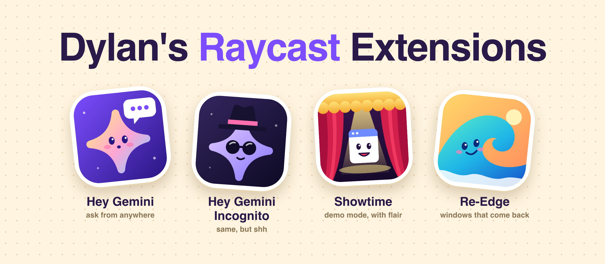
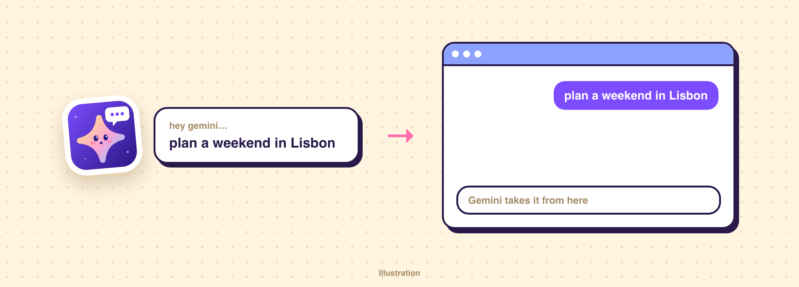
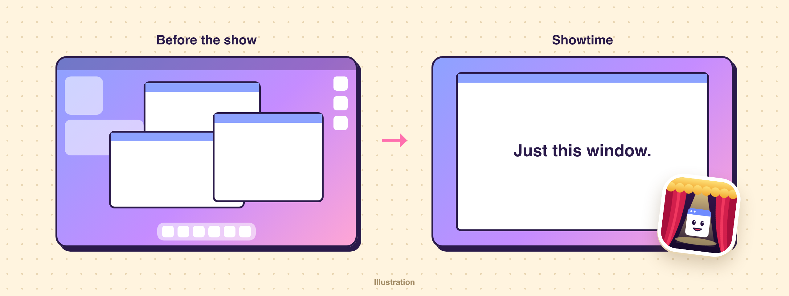
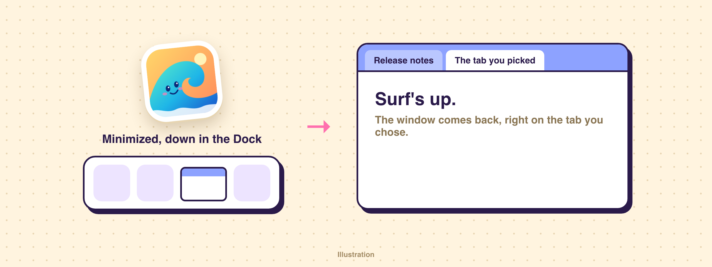

<p align="center">
  
</p>

A few little [Raycast](https://www.raycast.com) extensions I made for my Mac. Each one fixes a small annoyance, and each one gets its own tiny mascot.

<table>
  <tr>
    <td align="center" width="33%">
      <a href="extensions/hey-gemini"></a><br><br>
      <a href="extensions/hey-gemini"><strong>Hey Gemini</strong></a><br>
      Message Gemini from anywhere.
    </td>
    <td align="center" width="33%">
      <a href="extensions/showtime"></a><br><br>
      <a href="extensions/showtime"><strong>Showtime</strong></a><br>
      Demo mode for your desktop. One window, everything else offstage.
    </td>
    <td align="center" width="33%">
      <a href="extensions/re-edge"></a><br><br>
      <a href="extensions/re-edge"><strong>Re-Edge</strong></a><br>
      Pick an Edge tab and its minimized window comes back.
    </td>
  </tr>
</table>

## Hey Gemini



Hit your hotkey, type, press Enter. Gemini comes to the front and your message is sent, even if the app was hidden, minimized, or closed.

| | |
| --- | --- |
|  **Hey Gemini** | Sends to the chat you have open |
|  **Hey Gemini Incognito** | Starts a Temporary Chat first. Same thing, but shh. |

## Showtime



| | |
| --- | --- |
|  **Showtime** | Centers your window at 85% of the screen, hides other apps, desktop icons, and widgets, and auto-hides the Dock and menu bar |
|  **Curtain Call** | Puts it all back, with windows right where they were |

Searching "demo" in Raycast finds both.

## Re-Edge



A patched copy of the [community Microsoft Edge extension](https://www.raycast.com/KartikKumarSahoo/microsoft-edge). Picking a tab from **Search Tabs** used to leave a minimized window down in the Dock. Now it comes back to the front, and everything else works like the original.

## Try one

You'll need macOS, Raycast, and Node 22 or newer.

```bash
git clone https://github.com/dylandersen/raycast-extensions.git
cd raycast-extensions/extensions/hey-gemini   # or showtime, re-edge
npm install
npm run dev
```

Raycast imports it automatically. Press `Ctrl+C` once it's built, and it stays installed. Add a hotkey in Raycast Settings → Extensions.

macOS may ask you to allow Raycast under **Privacy & Security → Accessibility** and **Automation** the first time.

These work by driving other apps through macOS accessibility, so an app update can break them. Each extension's README lists its limits. The pictures above are illustrations, not screenshots.

## Credits

MIT, see [LICENSE](LICENSE). Re-Edge is adapted from [raycast/extensions](https://github.com/raycast/extensions/tree/main/extensions/microsoft-edge) by KartikKumarSahoo and contributors, and keeps [its own MIT license](extensions/re-edge/LICENSE).

This is a personal project, not affiliated with or endorsed by Raycast, Google, or Microsoft. Gemini and Microsoft Edge are trademarks of their respective owners.
