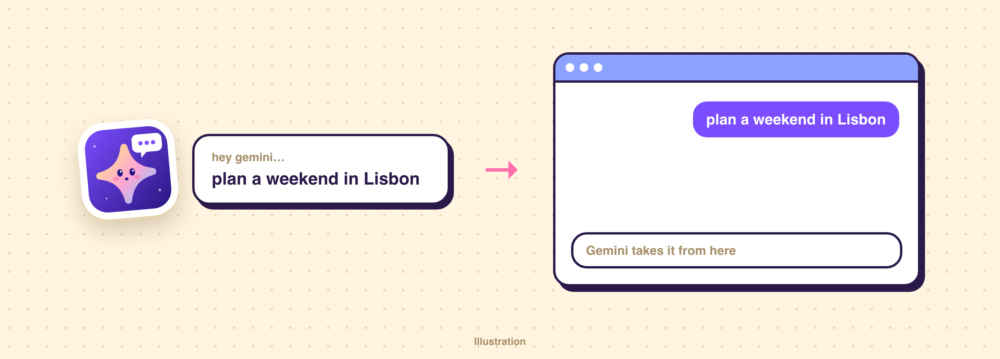

# Hey Gemini

Message the [Gemini](https://gemini.google.com) desktop app from anywhere.



| Command | What it does |
| --- | --- |
| **Hey Gemini** | Starts a new chat, then sends your text |
| **Hey Gemini Incognito** | Starts a Temporary Chat, then sends your text |

Either way, Gemini launches if it isn't running, comes to the front, and its window is centered without being resized. Your clipboard stays untouched. Searching "gemini" in Raycast finds both.

## Setup

You'll need the Gemini desktop app, Raycast, and Node 22 or newer.

```bash
npm install
npm run dev
```

Press `Ctrl+C` once it's built. Add a hotkey in Raycast Settings → Extensions, and allow Raycast under **Accessibility** if macOS asks.

## How it works

`assets/ask-gemini.js` uses macOS accessibility to find Gemini's message box, fill it in, and press Return. It tries the box that already has focus, then the box's known location, then searches the window starting from the main pane, because the sidebar can hold hundreds of chats.

## Limits

- The Raycast input is one line, so multi-line prompts aren't supported.
- It looks for a message box whose label starts with "Ask", and for Gemini's **New Chat** and **New Temporary Chat** menu items. A Gemini update could change either one.
- If sending fails, Raycast shows "Couldn't send to Gemini" and the reason.
