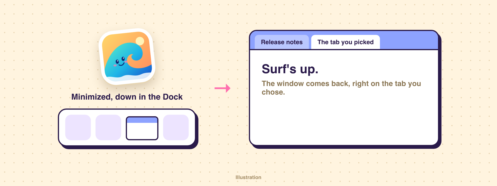
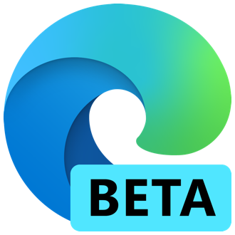

# Re-Edge

Your minimized Edge window, back from the deep.

A patched copy of the [community Microsoft Edge extension](https://github.com/raycast/extensions/tree/main/extensions/microsoft-edge) by KartikKumarSahoo and contributors, used under its [MIT license](LICENSE). Choosing a tab in **Search Tabs** used to switch tabs but leave a minimized window down in the Dock. Now the window comes back and jumps to the front. The change is in `setActiveTab` in `src/actions/index.ts`.

To install, run `npm install && npm run dev`, then press `Ctrl+C` once it's built. This copy doesn't get store updates, and the store screenshots were left out to keep the repo small.

---

**The original README:**

# Microsoft Edge Extension

Quick access to [Microsoft Edge](https://www.microsoft.com/edge/) - _the AI-powered browser_.

## 🚀 Features
- Open new tabs
- Search and jump to currently open tabs
- Search and open tabs from search query based on browser history across all profiles
- Search and open tabs from search query based on bookmarks across all profiles
- Directly copy the URL of the Topmost Active tab

## 🗒️ Notes

1. Open profile support is limited to opening tab in new profile window. You can customize default tab opening behaviour in `Preferences`.

2. If you are using `Default` mode and have multiple profiles open in parallel, the tab will open in the topmost window.

> These are due to limitations in the Microsoft Edge API.

## 💪 Supported

