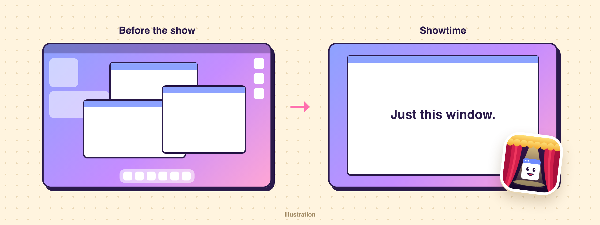

# Showtime

Demo mode for your desktop: one window in the spotlight, everything else offstage.



| Command | What it does |
| --- | --- |
| **Showtime** | Centers the active window at 85% of the screen, hides other apps, minimizes that app's other windows, hides desktop icons and widgets, and auto-hides the Dock and menu bar |
| **Curtain Call** | Restores your window positions, apps, icons, widgets, and Dock and menu bar settings |

Searching "demo" in Raycast finds both. Your original settings are saved to `~/.local/state/raycast-demo/state.json` during the show and removed afterward. The file survives a restart, so **Curtain Call** still works after one.

## Setup

You'll need Raycast and Node 22 or newer.

```bash
npm install
npm run dev
```

Press `Ctrl+C` once it's built, then allow Raycast under **Accessibility** and **Automation** if macOS asks.

## Limits

- **Finder restarts on the way in and out.** macOS needs this to hide desktop icons, and it can interrupt a file copy in progress. Folder windows reopen where they were, but windows without a folder path, like Recents, may not.
- **The Dock and menu bar auto-hide** rather than disappear, so they slide in if your cursor reaches that screen edge.
- **Apps with size limits** may not reach 85%, but they're still centered.
- **Windows closed during the show** can't be restored. Curtain Call tells you how many items it missed.
- **Full-screen windows** are untested.
